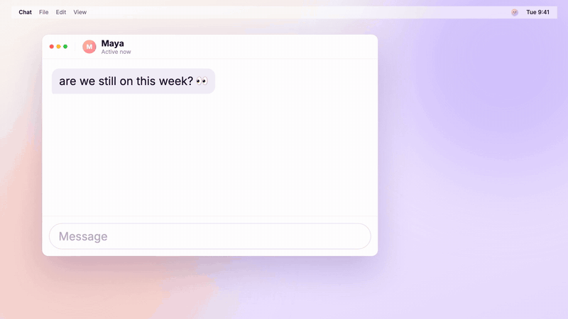

# Murmur 0.4.0 — local Whisper, no API key

Native macOS menu-bar dictation using a local Whisper model (via the open-source WhisperKit library) and conservative local text cleanup. No account, API key, paid API or cloud transcription. Version 0.3.0 replaces Apple speech recognition, so Dictation and Siri do not need to be turned on.

<p align="center"></p>

▶️ **[Watch the full launch video with sound](docs/murmur-launch.mp4)** (42 s)

## Install

1. Quit older Murmur copies from their menu-bar Quit command.
2. Place `Murmur.app` at a stable location, usually Applications, and open it. Opening/reopening the app shows Settings.
3. In Setup, download a speech model (Quick ~150 MB, Balanced ~220 MB, Best ~630 MB). This is the only network use: the model and its tokenizer come from Hugging Face (`argmaxinc/whisperkit-coreml`) and are stored in `~/Library/Application Support/Murmur/Models`. After that Murmur works offline.
4. Enable Microphone, Accessibility and Input Monitoring for this copy of Murmur. If macOS asks to quit and reopen, use Restart Murmur in Setup.
5. Optionally choose a language under Dictation. “Detect automatically” lets Whisper identify the language for each recording.
6. Focus an empty text field in another app, hold Fn, speak, and release.

Requires macOS 13 or later; the included app is for Apple silicon. This is an ad-hoc signed development build, not a notarized release. macOS controls whether it permits you to run local development software. No security protections have been disabled by the build or installer.

## Controls

- Hold Fn / Globe to talk; release to insert. A quick tap is ignored.
- Double-tap Fn for hands-free, or press Space while holding Fn; press Fn again to finish. A third tap within half a second of starting hands-free cancels.
- ⌃⌘V pastes your last dictation again at the current cursor.
- Escape cancels capture or processing.
- Control–Shift–Space is an always-available alternative, configurable under Shortcuts.
- Menu-bar start/stop/cancel and copy-last-result controls are also available.
- Recordings stop on their own after 10 minutes.

Murmur swallows only its own shortcuts (the Space in Fn+Space and ⌃⌘V) so they don't type into your app; every other key passes through untouched.

Fn is monitored as a modifier flag through a passive event tap. Murmur does not swallow system shortcuts. If Globe opens emoji/system dictation, set System Settings → Keyboard → “Press Globe key to” → “Do Nothing”. Some keyboards do not expose this flag; use the alternative. Secure Input, sleep, or lock cancels dictation. Captures stop at 55 seconds.

## Recognition and cleanup

Speech recognition is provided by Whisper running on this Mac through WhisperKit (Core ML / Neural Engine). Audio is never uploaded. Whisper adds its own punctuation and capitalization, so Verbatim mode keeps Whisper’s punctuation. Non-speech markers such as [BLANK_AUDIO] are removed.

- **Verbatim:** recognized text is returned unchanged. The recognizer itself may still normalize speech, so this is not a certified verbatim record.
- **Minimal:** trims spacing, adds basic initial capitalization and a final period when appropriate.
- **Balanced:** also removes standalone “um”, “uh” and “erm” and resolves adjacent, finite weekday/month corrections, such as “Tuesday, actually Thursday”. It preserves words like “like” and deliberate repetitions.

There is no AI grammar rewriting, general false-start resolution or Polished mode in this version. Existing Polished settings migrate to Balanced. Complex corrections such as a full change from Python to TypeScript remain intact rather than being guessed. Local cleanup can still make mistakes; review important text.

For a new paragraph, say “insert new paragraph”. The bare phrase “new paragraph” remains literal text. “Insert comma” and “insert question mark” are supported explicit commands. These commands are not applied in Verbatim mode.

Dictionary spellings are passed to Whisper as a prompt, which nudges it toward those spellings without guaranteeing them. Pronunciation notes are kept for reference only. Dictionary entries do not trigger blind text replacement.

Application awareness uses only the bundle identifier locally. In code editors it avoids changing initial case or adding a final period. It does not read browser tabs, document text, screenshots, selected text or window titles. Browser tabs use general formatting. There is no sophisticated email/message restructuring.

## Smart formatting, styles and snippets

All local, rule-based, and skipped in Verbatim cleanup:

- **Spoken punctuation:** “comma”, “period”/“full stop”, “question mark”, “exclamation point”, “colon”, “semicolon”, “em dash”, “new line”, “new paragraph”. After “a/the/this…” the words stay words (“a period of time”).
- **Lists:** “groceries one, milk. two, eggs.” becomes a numbered list. Markers must be followed by punctuation, so ordinary numbers in prose are left alone.
- **Backtrack:** “scratch that” / “never mind” drop the fragment before them; “at 2 actually 3”, “Friday, I mean Saturday” keep only the correction. “I actually enjoyed it” is untouched.
- **Press enter:** ending with “press enter” or “hit return” inserts the text, then presses Return.
- **Styles:** Formal, Casual (no trailing period) or Very casual (also lowercase sentence starts) for personal messages, work messages, email and everything else, detected from the app's bundle identifier. Browsers, AI chat apps and code editors get no style.
- **Snippets:** saying only a cue inserts its saved text exactly; a cue inside a sentence is swapped for its text.
- **Mute audio while dictating** (off by default) mutes the output device while recording and restores it afterwards.
- **Usage:** word count, words per minute and time saved (vs. typing at 40 wpm) appear in Settings. Only counts are stored, never text.

Not included, because they need a cloud language model: AI rewriting (“Command Mode”) and clarity edits.

## Insertion safety

Murmur captures the initial application's PID, focused Accessibility element and cursor range. Before insertion it requires the same app, field and cursor. It refuses password fields and nonempty selections, never replaces an entire field value, and never reactivates another app to paste into it.

Direct insertion uses the selected-text Accessibility attribute at a zero-length selection. An ambiguous failed write is not automatically retried. Optional clipboard fallback snapshots all pasteboard representations, sends one Command–V, waits 800 ms, and restores the clipboard only if no other app changed it. Paste dispatch cannot guarantee that every target consumed the content. Unsupported fields or changed focus leave the result available for manual copy instead.

## Privacy

This build contains no OpenAI API client or API-key access. It makes no transcription or cleanup network requests. The only network access is the one-time model and tokenizer download from Hugging Face, started by you in Setup.

Audio is recorded only after explicit activation and permission checks, into user-only temporary WAV files. Files are deleted after processing, cancellation or failure; crash leftovers are removed on next launch. The last text result stays in memory for recovery until a new session, cancellation or quit.

History is off by default. When enabled, successfully submitted text is saved in `~/Library/Application Support/Murmur/history.json`, with user-only permissions and a 200-entry cap. Retention is pruned while the app runs (on launch, when adding entries and while Settings is open), not by a background deletion service. Disable history or Delete all local history to remove it immediately. Settings and dictionary remain local in the same Application Support folder. Any API key previously saved by 0.1.x is not read, used, or deleted by this version; you can remove the `com.steph.murmur`/`openai` entry in Keychain Access if you created one.

## Build and checks

```sh
./scripts/build-app.sh release
./scripts/test.sh
```

Swift 5.9+ and Command Line Tools are sufficient; the first build fetches the WhisperKit package (pinned to 1.1.1) from GitHub. Open Package.swift in Xcode if desired.

The build stages a fresh signed bundle and swaps whole directories, avoiding in-place modification of running executables. `MURMUR_SIGN_IDENTITY` can supply a Developer ID for external distribution; notarization/stapling requires your own Apple credentials. A local build is not production qualification.

A noninteractive diagnostic is available:

```sh
./build/Murmur.app/Contents/MacOS/Murmur --check-speech-support
```

It reports whether the selected Whisper model is downloaded, without loading it, recording, or using the network.

The dependency-free checks exercise local cleanup behavior, settings migration, shortcuts, cancellation/session tokens and insertion policies. They do not validate the hardware microphone, actual recognition quality, permission grants, or every application's Accessibility behavior. See VALIDATION.md.

## Architecture

`MurmurCore` contains settings, provider protocols, local cleanup, shortcut/session state machines and insertion policies. `Murmur` contains the Whisper speech model manager, selected-microphone recording, keyboard monitor, target insertion, menu-bar lifecycle, SwiftUI settings and nonactivating waveform overlay. Recognition has cancellation, once-only continuation completion and a 60-second processing timeout. Failed recognition is never replaced by guessed or example text.

Apple references: [on-device support](https://developer.apple.com/documentation/speech/sfspeechrecognizer/supportsondevicerecognition), [requiring local recognition](https://developer.apple.com/documentation/speech/sfspeechrecognitionrequest/requiresondevicerecognition), [speech authorization](https://developer.apple.com/documentation/speech/asking-permission-to-use-speech-recognition).

## License

MIT. See [LICENSE](LICENSE). Murmur uses [WhisperKit](https://github.com/argmaxinc/WhisperKit) (MIT) and OpenAI Whisper models (MIT), downloaded separately at first run.
